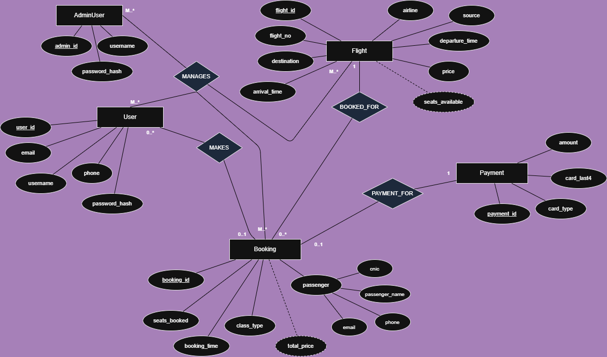

# Aether Airlines - Airline Management System

A full-stack airline booking and management platform built for a Database Management Systems course.
Passengers can search flights, book seats and pay online; admins manage flights, schedules, crew, operations and reports.

**Stack:** React (Vite) | Flask REST API | MySQL | JWT authentication | Stripe Checkout (test mode)

## Features
- Role-based access: separate **User** and **Admin** dashboards
- Flight search and booking flow for passengers
- Stripe Checkout integration in **test mode** (no real payments)
- JWT-protected API with hashed passwords
- Admin tools for flights, schedules, crew, operations and reports
- Normalized MySQL schema (3NF) with keys and constraints - see `db/all_tables.sql`

## Database design
ERD and data-flow diagrams are in [`docs/`](docs/).



## Project structure
```
backend/    Flask API (routes for auth, flights, bookings, payments, admin)
db/         MySQL schema and helper scripts
docs/       ERD and DFD diagrams
frontend/   React + Vite client
```

## Run locally

### 1. Database
Create the schema in MySQL:
```bash
mysql -u root -p < db/all_tables.sql
```

### 2. Backend
```bash
cd backend
python -m venv venv
venv\Scripts\activate        # Windows (use `source venv/bin/activate` on macOS/Linux)
pip install -r requirements.txt
copy .env.example .env       # then fill in DB_PASSWORD, SECRET_KEY and your Stripe TEST key
python create_admin.py       # create an admin account
python app.py
```

### 3. Frontend
```bash
cd frontend
npm install
copy .env.example .env       # add your Stripe TEST publishable key
npm run dev
```
The frontend expects the API at `http://127.0.0.1:5001`.

## Notes
- Use Stripe **test** keys only. Never commit real keys - `.env` files are git-ignored.
- Built as a university project; some screens and the admin seed flow are for demonstration.
